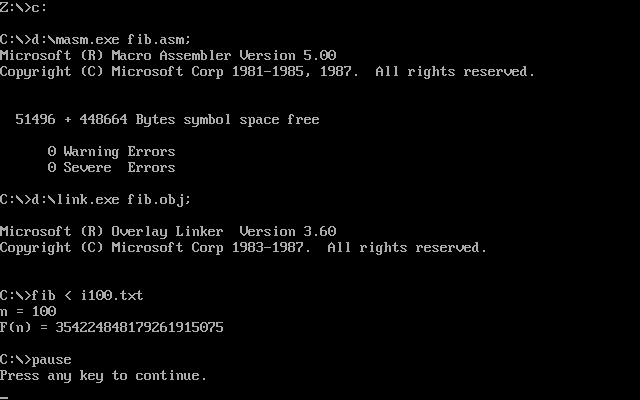
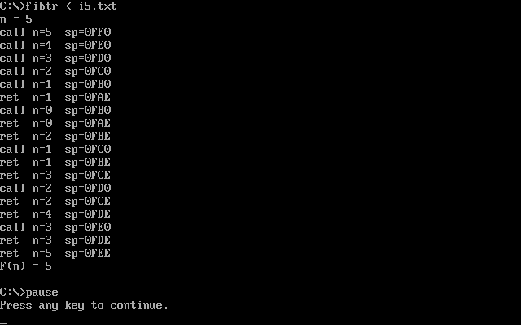

# 汇编作业 5：递归调用（斐波那契数列）

## 题目要求

- 键盘输入 n（1 ≤ n ≤ 100），输出第 n 个斐波那契数，F(0)=0，F(1)=1
- 必须用递归实现
- 过程中使用寄存器
- 自己初始化栈空间，并说明开多大不会 Stack Overflow
- 单步跟踪，观察每次调用/返回时栈空间的变化
- 用 C 语言实现，看反汇编并加注释

## 运行环境

- DOSBox 0.74
- MASM 5.0 + LINK 3.60（16 位 DOS 程序）

## 文件说明

| 文件 | 说明 |
|---|---|
| `fib.asm` | 正式版（MASM 汇编） |
| `fibtr.asm` | 调试版，在 fib 入口/出口打印 n 和 SP，用来看栈变化 |
| `fib_c.c` | C 语言实现（同样的记忆化 + 万进制） |
| `fib_c_compiler.asm` | 用 cl /FA 生成的汇编清单 |
| `fib_c_obj_disasm.txt` | 用 dumpbin /disasm 反汇编 fib_c.obj 的结果 |
| `fib_c_disasm_notes.txt` | 反汇编加注释 |
| `docs/out5.txt` / `docs/out100.txt` | 运行结果示例 |
| `docs/trace5.txt` / `docs/trace100.txt` | 调试版打印的调用/返回过程 |
| `docs/dosbox_demo.png` | 编译、链接、运行 n=100 的截图 |
| `docs/trace_demo.png` | 调试版跑 n=5 时打印的调用/返回和 SP |

## 实现思路

1. **递归**：`fib(n)` 先算 `fib(n-1)`、`fib(n-2)`，再把两个结果加起来。
2. **记忆化**：如果每次都老老实实递归，n=40 以后就慢得不行。所以开了一个 `valid[101]` 数组，算过的 n 直接返回 `memo[n]`。这样每个 n 只真正算一次。
3. **大数**：F(100) 有 21 位，16 位寄存器装不下。把每个数拆成 6 个万进制位组（每个字存 0~9999），加法时按组加、满 10000 进位。打印时最高组不补零，后面每组补足 4 位。

寄存器分工：

- `AX`：传参，也是乘除法的累加器
- `BP`：保存当前的 n
- `SI` / `DI`：memo 的地址偏移
- `BX`、`CX`：循环和位组下标
- `DX`：加法进位、除法余数

## 栈空间

`fib` 每进一层压 7 个寄存器（ax、bx、cx、dx、si、di、bp）再加一条 `call` 压入的返回地址：

```
7 * 2 + 2 = 16 字节/层
```

n 最大 100，所以递归最深 100 层，占用 `100 * 16 = 1600` 字节。再加上主程序自己的少量开销，栈开 4 KB（4096 字节）完全够用，还留了一倍多富余。如果只按 DOS 默认的栈（一般 256 字节）肯定会溢出，所以这里显式声明了 `stack` 段。

实测跟踪（`docs/trace100.txt`）：进入 `fib(100)` 时 SP=0FF0，最深一层 `fib(1)` 时 SP=09B0，正好差 `0x640 = 1600` 字节，和上面的计算一致。

## 编译运行

在 DOSBox 里：

```
mount c "d:\huibian\myasm\asm-homework\assignment5_fibonacci"
mount d "d:\huibian\myasm"
c:
d:\masm.exe fib.asm;
d:\link.exe fib.obj;
fib
```

调试版同理，把 `fib` 换成 `fibtr`。

## 运行结果

| n | F(n) |
|---|---|
| 0 | 0 |
| 1 | 1 |
| 2 | 1 |
| 5 | 5 |
| 10 | 55 |
| 20 | 6765 |
| 30 | 832040 |
| 50 | 12586269025 |
| 90 | 2880067194370816120 |
| 100 | 354224848179261915075 |

完整对照见 `verification.txt`。

## 截图





## 踩过的坑

- 一开始打印结果一直不对，打出来是数据段开头的字符串。查了半天发现是主程序里算完 `n*12` 之后直接拿去当 `SI` 用了，忘了加 `memo` 的基址，改成 `lea si, memo` 再 `add si, ax` 就对了。
- 一开始用 5 个 16 位字按二进制存大数，打印时低位字会超过 9999，`print_4` 就打出奇怪的字符。后来改成 6 个万进制位组，每组的进位单独处理。
- `print_trim` 遇到 0 什么都不打（全是前导零），调试版里 `fib(0)` 那行就变成 `n=` 后面空的，加了个判 0 的分支。
- 文件名超过 8.3 格式（比如 `fib_trace.asm`）MASM 会报 `Unable to open input file`，改成 `fibtr.asm` 才行。


